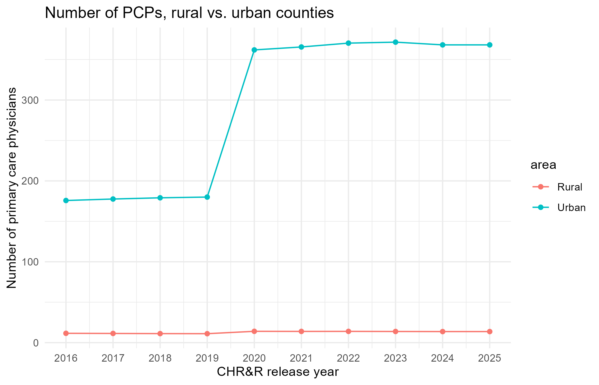

```{r, here-i-am, include = FALSE}
here::i_am(
  "report.Rmd"
)
```

```{r setup, include=FALSE}
knitr::opts_chunk$set(warning = FALSE, message = FALSE)
```

# Introduction

The **County Health Rankings & Roadmaps dataset** provides county-level metrics focused on health outcomes and socioeconomic factors in the United States. With a range of information about the health status of almost every county in the US, analysis of region-specific trends in this dataset can answer interesting research questions, from insights on obesity, smoking, food insecurity, insurance rates, and dozens of other metrics. With this benefit in mind, we want to analyze the health gaps between urban and rural counties in the United States using a few of these variables.

We seek to answer these questions:

- Does the infant mortality rate in urban vs. rural counties differ significantly?

- Does the percentage of children in poverty in urban vs. rural counties differ significantly?

- Do the years of potential life lost rates in urban vs. rural counties differ significantly?

- Does the number of primary care physicians in urban and rural counties vary over time?

# Data Cleaning

First, we need to download each year's dataset and merge them together.

There are two different csv files storing different variables from the same overall dataset for each year, so they should be combined. Merge the ranked datasets together and the additional datasets together for each year.

We merge the additional and ranked data together.

We filter out the columns we don't need to analyze, as there are many.

We now have a final dataset to use, but need to do a little bit more cleaning. First, some columns are characters but should be numeric.

We also need to add a rural vs. urban variable, as we only have the percentage of each county that is considered rural. Here, if a county is defined as over 50% rural, we consider it rural, otherwise it is urban.

# Table

Finally, we can generate our table. The following table uses the gtsummary and labelled packages.

```{r, load-table}
readRDS("output/table.rds")
```
In the table, we include:

- area, or whether a county is urban or rural

- infant mortality rate, or the number of deaths of infants under one year of age per 1,000 live births

- percent children in poverty, defined as the percentage of people under age 19 living in a household with income below the federal poverty level

- years of potential life lost rate, defined as the years of potential life lost before age 75 per 100,000 people (for example, a death at 30 years of age would contribute 45 years)

The table compares these variables between rural and urban counties from 2016-2025. Results show that rural counties have more people than urban ones in the US, overall. Rural environments also have significantly worse health outcomes than urban ones. Rural environments have a higher infant mortality rate, a higher percentage of children living in poverty, and a higher years of potential life lost rate, all with $p < 0.001$ by the Wilcoxon rank sum test.

# Figure

Now, we generate our figure.

```{r, load-figure}

```

This figure averages the number of primary care physicians from 2016-2025 for both urban and rural counties and plots the means over time. We can see that there is a large difference in number of primary care physicians from urban to rural counties, but some of this gap can be attributed to the fact that less people live in rural counties overall, and thus not as many PCPs would be necessary. An interesting trend here is that in 2020, the number of PCPs in urban environments spiked, likely due to the COVID-19 pandemic, but the number of PCPs in rural environments barely changed at all. This could be a representation of the varying responses, based on location, to the pandemic and differing action that was taken.
